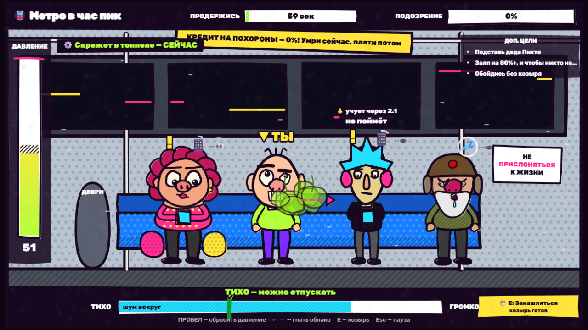
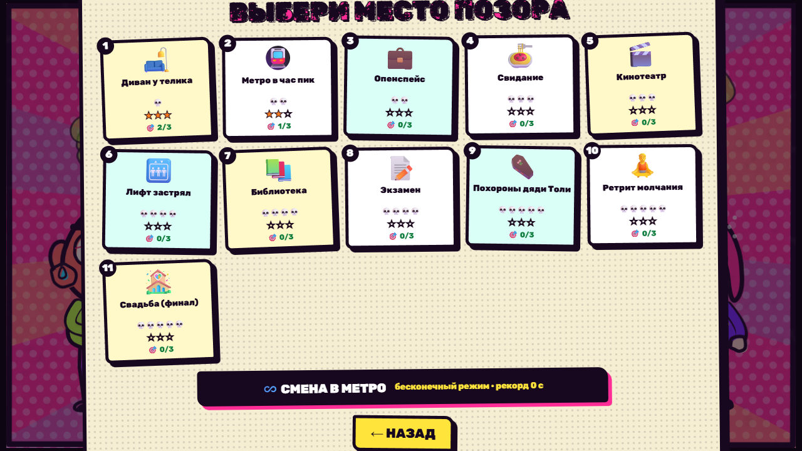

# Тихий выхлоп

**[▶ Играть в браузере](https://sosamb0.github.io/TihijVyhlop/)**: на компьютере и на телефоне.

Симулятор социального выживания. Давление в животе растёт, а вокруг люди. Нужно сбрасывать газ так, чтобы никто не услышал и не учуял, и продержаться 60 секунд. Чёрный юмор, кислотный комикс, 11 мест позора и бесконечный режим.



## Как играть

| Компьютер | Телефон | Что делает |
|---|---|---|
| **Пробел** (зажать и отпустить) | кнопка «ЗАЖМИ» | сбросить давление. Чем дольше держишь, тем больше уйдёт, но тем громче |
| **← →** | кнопки ← → | гнать облако. Пунктир показывает, куда его несёт, табличка над головой — кто учует и на кого подумает |
| **E** | кнопка ★ | козырь: один раз за уровень создать свой громкий момент |
| **Esc** / **M** | II | пауза / звук |

- Внизу шкала шума. Пока твоя метка в синей зоне, тебя не слышно.
- У каждого персонажа свой ритм: спит, сидит в телефоне, косится на тебя. Кольцо вокруг значка показывает, сколько ещё так будет. **!** над головой — сейчас повернётся к тебе.
- Кто учуял облако, винит того, кто к нему ближе. Подставь кота, деда или покойника.
- У каждого уровня 3 доп. цели. Они по желанию и на звёзды не влияют.

## Уровни

1. Диван у телика
2. Метро в час пик
3. Опенспейс
4. Свидание
5. Кинотеатр
6. Лифт застрял
7. Библиотека
8. Экзамен
9. Похороны дяди Толи
10. Ретрит молчания
11. Свадьба (финал по сценарию)

Плюс **«Смена в метро»**: бесконечный режим на рекорд. Открывается после третьего уровня.



## Разработка

Игра — один файл `index.html` без зависимостей: его и раздаёт GitHub Pages. Он **собирается** из исходников в `src/`, руками его не правят.

```
src/
  index.template.html  разметка меню и экранов
  style.css            стили меню
  js/                  код игры (склеивается в этом порядке):
    util.js            рисование «тушью», текст, математика
    save.js            прогресс в localStorage
    audio.js           звуки: записи + синтез
    lines.js           реплики персонажей
    chars.js           рисование персонажей
    levels.js          уровни, козыри, доп. цели, бесконечный режим
    game.js            вся игровая логика
    scenes.js          фоны локаций
    render.js          отрисовка игры и интерфейса
    touch.js           кнопки для телефона
    menu.js            меню и клавиатура
    main.js            игровой цикл
  sounds.json          записи звуков (base64)
  credits.json         авторы звуков
  bot.js               бот для проверки баланса
tools/
  balance.mjs          прогон бота в headless-браузере
  screenshot.mjs       скриншоты для README
```

Собрать после правок:

```bash
python src/build.py
```

Проверить баланс: бот проходит каждый уровень N раз и печатает таблицу побед.

```bash
npm install
npx playwright install chromium
npm run balance -- 20
```

На каждый push GitHub Actions проверяет, что `index.html` пересобран, и прогоняет бота. Таблица появляется в сводке запуска. Проверка падает, если игра выдаёт ошибки JavaScript, какой-то уровень стал почти непроходимым или проходится спамом слабыми залпами.

Новый уровень — это объект в `LEVELS` (`src/js/levels.js`), фон в `SCENES` (`src/js/scenes.js`) и строка в `EXTRA` с козырем и целями.

## Звуки

Записи взяты с [Wikimedia Commons](https://commons.wikimedia.org/) по свободным лицензиям (CC BY-SA, CC BY, Public domain), авторы перечислены в игре в меню «Звуки и авторы» и в `src/credits.json`. Записи обрезаны, нормализованы и разрезаны на отдельные звуки (`src/process_sounds.sh`). Остальные звуки синтезируются прямо в браузере.
